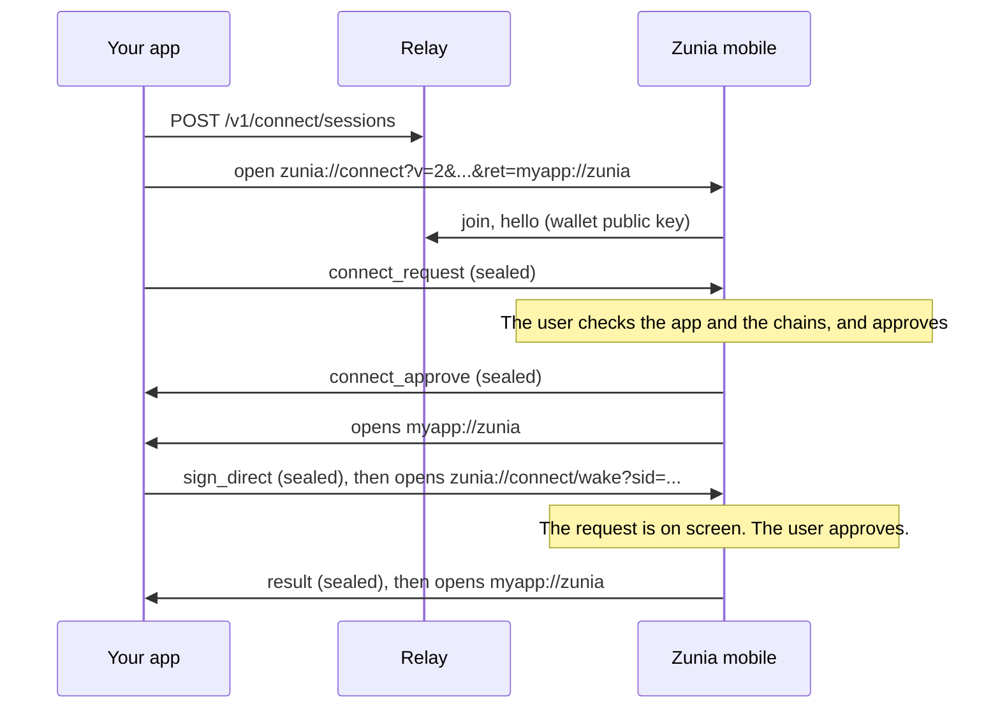

# Use Zunia mobile from another app

On one phone, another app can use Zunia mobile as its wallet, the way apps open Keplr with a deep link: a native app (Flutter, Swift, Kotlin, React Native) or a website open in the phone's browser. Nothing is scanned. Your app opens Zunia with the pairing link, the user approves there, and Zunia brings them back.

Underneath it is the same [`zunia.connect.v2`](../reference/connect-v2.md) session as [QR pairing](./qr.md): encrypted end to end, through the Zunia relay at `api.zunialab.com`. Two link features make it work on one device:

- **`ret`**, an optional parameter of the pairing link: where Zunia goes once the user answers.
- **The wake link**, `zunia://connect/wake?sid=<session id>`: brings a paired session up in Zunia so the user sees the request waiting there.

## How it goes



1. Your app creates a session at the relay and builds the pairing link, with `ret` set to your return target.
2. It opens that link. The phone switches to Zunia, which joins the session and receives your connect request.
3. The user approves or declines. Zunia then opens `ret`, and the user is back in your app with the answer.
4. For each later request, your app sends it, then opens the wake link. Zunia comes to the front with the request on screen. After the answer it opens `ret` again.

Zunia follows `ret` only when the pairing link opened it on the same phone. A scanned QR code never sends anyone anywhere, which is why the SDK keeps `ret` out of the QR code.

## What the user sees

- **Pairing:** Zunia's connect sheet with your app's name and icon, the chains you ask for, and a 6-digit code. Show the same code in your app (`verificationCode`) so the user can compare the two.
- **Origin:** for a website, Zunia shows the origin the relay saw when the page created the session. A native app sends no web origin, so Zunia says it could not confirm which site this is. It still connects and signs, but it refuses [Sign in with Zunia](./sign-in.md) messages from such a session (`ORIGIN_MISMATCH`), because it cannot bind them to a domain.
- **Requests:** each signature opens Zunia's review screen, the same as for a website.
- **After answering:** Zunia opens your return target. If there is none, the user switches back themselves (on iPhone, the back link at the top left of the status bar).

## From a website on the phone

`@zunialab/sdk-web` 0.2.0 and later do all of this for a page open in a phone or tablet browser:

- `pairing.appUri` is the pairing link with `ret` set to this page's address. `ConnectPairingModal` leads with **Open the Zunia app**, a link to it; build your own with `isPhoneBrowser()` and `pairing.appUri`.
- When the user taps that link (the SDK notices the tap), or your button calls `session.openWallet()`, the session counts as paired from this phone. That survives a reload.
- On such a session, each signing request (`signAmino`, `signDirect`, `signArbitrary`, `signIn`) opens the wake link as soon as the relay confirms it holds the request. The account refresh after a reload never does.

```ts
const session = createZuniaSession({
  nativeWs: {
    returnUrl: "https://app.example.com/swap", // default: this page's address
    openWallet: "auto", // or "never"
  },
});
```

- `returnUrl`: an `https:` URL or your app's own scheme, at most 512 characters. An invalid one fails `connect` with `INVALID_PARAMS`. Without it, an `http:` page (local development) pairs with no return target.
- `openWallet: "never"`: the SDK never opens Zunia by itself and adds `ret` only when you pass `returnUrl`. Offer a button that calls `session.openWallet()`; it opens the pairing link while pairing and the wake link once paired.

Browsers on phones have their own rules. Expect the browser to ask before it opens Zunia ("Open in Zunia?"). A browser may refuse to open an app when no tap happened recently, for example after a long gas estimate: keep a visible **Open Zunia** button that calls `session.openWallet()`. A browser may also open the return address in a new tab; `restore()` picks the paired session up there. Try the whole flow on a real iPhone and a real Android phone.

## From a native app

For Flutter, use the Dart client documented in [Flutter](./flutter.md). Other stacks implement the protocol from [`zunia.connect.v2`](../reference/connect-v2.md), checked against `test-vectors/connect-v2-vectors.json` in `@zunialab/sdk-core`:

1. `POST https://api.zunialab.com/v1/connect/sessions`. Keep `dappToken` private, in the keychain or keystore.
2. Make an X25519 key pair. Build `zunia://connect?v=2&sid=…&t=<walletJoinToken>&pk=<your public key, unpadded base64url>&r=wss://api.zunialab.com&ret=<your return target>`. Percent-encode `r` and `ret`.
3. Open the socket (`role=dapp`, subprotocols `zunia.connect.v2` and `zunia.token.<dappToken>`), then open the pairing link with the system (`UIApplication.open`, an `ACTION_VIEW` intent, `url_launcher`).
4. On `hello`, derive the keys and the 6-digit code, and send the sealed `connect_request`.
5. Save the session keys and both sequence numbers before each frame leaves, so a restart resumes instead of pairing again.
6. After each request, open `zunia://connect/wake?sid=<sessionId>`.
7. When your app comes back to the foreground, reconnect at once. The relay kept what Zunia sent meanwhile (up to 32 frames, 1 MiB, 10 minutes).

Keep each sealed frame under 512 KiB, and treat a relay `QUEUE_FULL` error as a failed request. See [Lifetimes and limits](../reference/connect-v2.md#lifetimes-and-limits).

## The return target

`ret` must be an `https:` URL with a host, or a URL in your app's own scheme. Zunia ignores, and pairs without, a target that uses `zunia`, `zuniamobile`, `wc`, `javascript`, `data`, `file`, `blob`, `about`, `content`, `intent` or `http`, that has characters outside RFC 3986, or that is longer than 512 characters. `isValidReturnUrl` in `@zunialab/sdk-core` is the same rule.

| | Custom scheme (`myapp://zunia`) | Universal Link / App Link (`https://app.example.com/zunia`) |
|--|--|--|
| Setup | iOS: `CFBundleURLTypes` in `Info.plist`. Android: an `intent-filter` with `VIEW`, `DEFAULT`, `BROWSABLE` and `<data android:scheme="myapp"/>`. | iOS: Associated Domains (`applinks:app.example.com`) and an `apple-app-site-association` file. Android: an `autoVerify` intent filter and `assetlinks.json`. |
| Who receives it | Any app that registered the same scheme can claim it. | Only your app, verified against your domain. |
| App not installed | Nothing opens. | The page opens in the browser. |

Either way, the return target carries no secret: never put a token or a session id in it. The session lives at the relay and in your app, not in the link.

## Opening Zunia

- Use the `zunia://` links. The `https://zunialab.com/connect` and `/connect/wake` forms do not open the app yet: the app-link files on zunialab.com still hold placeholders.
- iOS: `UIApplication.open` needs nothing. `canOpenURL` to check that Zunia is installed needs `zunia` in `LSApplicationQueriesSchemes`.
- Android 11 and later: starting the intent needs nothing. `resolveActivity`, `canLaunchUrl` or any other check needs a `<queries>` entry for the `zunia` scheme.
- When Zunia is not installed, offer the QR code (another phone can scan it) or a link to install Zunia.

Zunia mobile 0.1.0 is not on the App Store or Google Play yet; see [Zunia mobile](../use-wallet/mobile.md).
