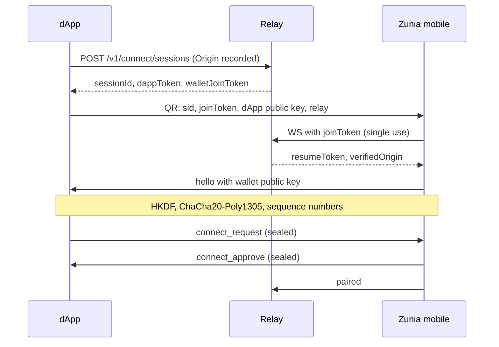

# Connect a phone by QR

A page and Zunia mobile pair through `zunia.connect.v2`. The relay only forwards ciphertext. Both screens show the same 6-digit code so the user can see they are talking to each other. Zunia mobile calls this connection **Zunia Connect**, and lists its sessions under **Connected apps**.

Zunia runs the relay at `https://api.zunialab.com`. Pass it as `apiBase`. Any site may open sessions there, within per-address rate limits. Its source is [zunia-backend](https://github.com/Zunia-Lab/zunia-backend).

```ts
import { createZuniaSession, renderQrSvg } from "@zunialab/sdk-web";

const session = createZuniaSession();

session.on("pairing", ({ uri }) => {
  dialog.innerHTML = renderQrSvg(uri, { size: 240, label: "Scan with Zunia" });
});
session.on("verification", (code) => {
  dialog.textContent = `Your phone should show ${code.slice(0, 3)} ${code.slice(3)}`;
});

await session.connect({
  chains: ["cosmoshub-4"],
  prefer: "native-ws",
  apiBase: "https://api.zunialab.com",
  metadata: { name: "My dApp", url: location.origin },
});
```

On React, `ConnectPairingModal` does this.

## On a phone

A phone cannot scan its own screen. In a phone or tablet browser, `ConnectPairingModal` leads with **Open the Zunia app**, a link to `pairing.appUri`, and keeps the QR code below it for pairing another phone. On a computer it shows only the QR code: a `zunia://` link has nothing to open there. `showAppLink` overrides the detection, and `isPhoneBrowser()` from `@zunialab/sdk-web` is the same test for your own dialog.

`pairing.appUri` is the pairing link plus `ret`, this page's address by default, so Zunia brings the user back once they answer. After pairing that way, each signing request opens Zunia on its own (a wake link). [Use Zunia mobile from another app](./app-to-app.md) explains both, and how to turn them off. These need `@zunialab/sdk-web` 0.2.0 or later; before it, the modal showed the plain `pairing.uri` link on every device.

An unscanned code expires after 10 minutes. After the wallet sends `paired`, the room lasts 24 hours.

## What travels



The QR holds a one-time `walletJoinToken`, the dApp public key and the relay address. The `dappToken` never goes in the QR. Application frames are opaque to the relay. The protocol is in [zunia.connect.v2](../reference/connect-v2.md).

## Verified origin

When the page creates the session, the relay stores the browser `Origin` header as `verifiedOrigin` and gives it to the wallet. The phone shows that origin. If the dApp's metadata URL is a different site, the wallet warns ("This site is not where it says") and refuses sign-in.

`verifiedOrigin` is only as trustworthy as the relay. A relay you do not control can invent one. Zunia mobile therefore only opens pairing URIs whose relay is on its **trusted list**: `wss://api.zunialab.com` by default, plus relays added at build time (`ZUNIA_CONNECT_TRUSTED_RELAYS`, `CONNECT_WS_PUBLIC_URL`) and, in debug builds, relays on the same machine or local network. A QR that names any other relay is refused.

So pass `apiBase: "https://api.zunialab.com"`. A relay you run yourself only pairs with a debug build of Zunia mobile, or with one you built with that relay on its list.

## After a reload

`session.restore({ apiBase, chains })` reopens the WebSocket with the stored dApp token and session keys. The wallet uses its `resumeToken`. Counters keep going, so a replayed frame is ignored.

## Limits

The relay carries frames of at most 512 KiB. The SDK refuses a request that would be larger once encrypted, before anything leaves: `INVALID_PARAMS` with `reason: "too-large"`. Split such a transaction.

While the phone is offline, the relay keeps up to 32 frames (1 MiB) for it, for 10 minutes. A request beyond that fails at once with `NETWORK` and `reason: "queue-full"`, instead of waiting out the 5-minute timeout; ask the user to open Zunia, then try again. Both need sdk-web 0.2.0 or later. See [Lifetimes and limits](../reference/connect-v2.md#lifetimes-and-limits).

## Deep links

| Kind | Example |
|------|---------|
| Pairing, custom scheme | `zunia://connect?v=2&sid=…&t=…&pk=…&r=…`, plus `&ret=…` in the app link |
| Pairing, Universal / App Link | `https://zunialab.com/connect?…` or `https://link.zunialab.com/connect?…` |
| Wake a paired session | `zunia://connect/wake?sid=…`, `https://zunialab.com/connect/wake?sid=…` or `https://link.zunialab.com/connect/wake?sid=…` |

Those HTTPS links do not open the app yet. Zunia mobile declares them, but they also need an `apple-app-site-association` file and an `assetlinks.json` file on each host, and the ones in the zunialab.com site still hold placeholders for the Apple Team ID and the Play signing certificate fingerprint. Use the `zunia://` links.
